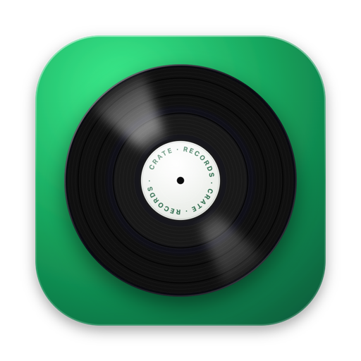
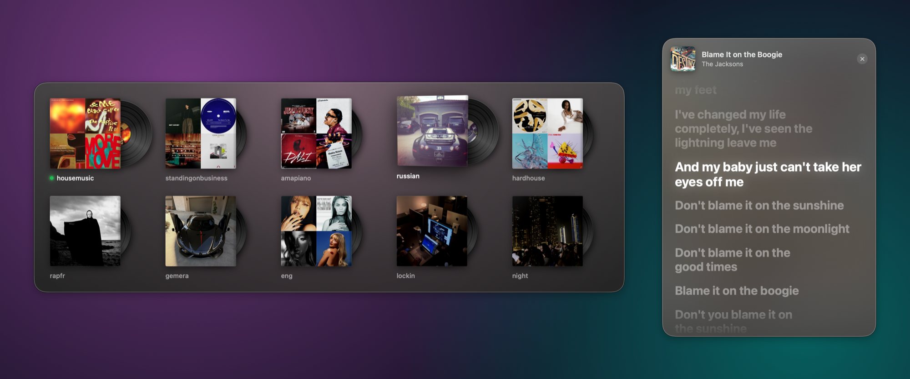
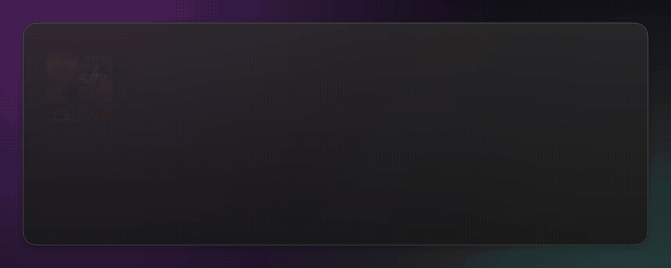

<p align="center">
  
</p>

<h1 align="center">Crate</h1>

<p align="center">
  <b>Tes playlists Spotify, rangées comme un bac à vinyles.</b><br>
  Choisis-en une, lis les paroles, passe à la suivante, tout au clavier, sans jamais ouvrir la fenêtre de Spotify.
</p>

<p align="center">
  
  
  
  
</p>

<p align="center">
  <a href="README.md">🇬🇧 Read in English</a>
</p>



## Ce que ça fait

| | |
|---|---|
| **⌘ ⌥ à · Choisir une playlist** | Une grille de pochettes apparaît. Au survol, le vinyle sort de sa pochette et tourne, et le fond prend la couleur de la pochette. Clique dessus (ou tape son numéro) : elle se lance en aléatoire. Spotify reste caché, même s'il était fermé. |
| **⌘ ⌥ ) · Paroles** | Une fenêtre flottante affiche les paroles de la musique en cours, synchronisées ligne par ligne façon karaoké. Clique sur une ligne pour aller à ce moment de la chanson. Le bouton à côté de × la réduit en un petit bandeau avec seulement la ligne en cours et la suivante, la ligne en cours s'allumant mot par mot pendant qu'elle est chantée. |
| **⌘ ⌥ - · Musique suivante** | Passe à la musique suivante, depuis n'importe quelle app. |

<p align="center">
  
</p>

En détail :

- La playlist en cours est marquée d'un point vert et son vinyle continue de tourner.
- Si le son est coupé ou que le volume de Spotify est à 0, Crate le remonte au lancement d'une playlist.
- Dans le menu : flèches, Entrée, Échap, et les touches 1…0. ⌘ , ouvre ta liste de playlists.
- Les raccourcis et les playlists sont dans un simple fichier texte, pris en compte dès que tu l'enregistres.
- L'interface est en français ou en anglais, selon la langue de ton Mac.

## Gratuit, et sans Premium

Crate n'utilise pas l'API Web de Spotify, qui exige Premium pour contrôler la lecture et un compte développeur. Il **pilote l'app Spotify déjà installée sur ton Mac**, comme le font l'app Raccourcis ou AppleScript : ça marche donc avec un **compte Spotify gratuit**. Pas de connexion, pas de clé d'API, rien à configurer côté Spotify.

- **Les pochettes** viennent des infos publiques de Spotify, celles qui s'affichent quand on colle un lien dans une conversation.
- **Les paroles** viennent de [LRCLIB](https://lrclib.net), une base de paroles libre et gratuite.

> Les règles de Spotify s'appliquent toujours : avec un compte gratuit, il y a des pubs, et c'est Spotify qui décide du nombre de musiques que tu peux passer.

## Installation

Compte environ 5 minutes. Il te faut un Mac sous **macOS 14 Sonoma ou plus récent** et l'[app Spotify pour ordinateur](https://www.spotify.com/download).

### 1. Installer les outils développeur d'Apple

Crate est compilé sur ton Mac à partir de son code source, ce qui demande les Command Line Tools d'Apple (gratuits). Ouvre le **Terminal** (dans Applications › Utilitaires) et colle :

```bash
xcode-select --install
```

Clique sur **Installer** dans la fenêtre qui s'ouvre et attends la fin (quelques minutes). S'il te dit que les outils sont déjà installés, c'est bon.

### 2. Télécharger et installer Crate

Toujours dans le Terminal, colle cette ligne :

```bash
git clone https://github.com/amndrd/crate.git ~/Crate && ~/Crate/install.sh
```

Elle télécharge Crate dans un dossier `Crate` de ton dossier personnel, compile l'app et la lance automatiquement à chaque ouverture de session. À la fin, `config.txt` s'ouvre dans TextEdit.

> Tu peux déplacer le dossier plus tard : Crate le suit et continue de se lancer à l'ouverture de session. Évite le Bureau, Documents et Téléchargements : macOS protège ces dossiers et demanderait une autorisation en plus.

### 3. Ajouter tes playlists

`config.txt` liste tes playlists, un lien Spotify par ligne. Pour copier le lien d'une playlist dans Spotify, clique sur **•••** à côté d'elle, puis **Partager › Copier le lien de la playlist**.

```ini
[playlists]
Chill = https://open.spotify.com/playlist/37i9dQZF1DWWQRwui0ExPn
Sport = https://open.spotify.com/playlist/37i9dQZF1DX76Wlfdnj7AP
https://open.spotify.com/album/2noRn2Aes5aoNVsU6iWThc
```

- Le nom avant `=` est facultatif : sans lui, Crate reprend le nom de la playlist sur Spotify.
- Les albums et les artistes marchent aussi.
- Les 10 premières se choisissent avec les touches 1…0.

Enregistre (⌘ S). Crate recharge le fichier aussitôt et affiche le nombre de playlists trouvées.

### 4. Essayer

Appuie sur **⌘ ⌥ à** (Commande + Option + à ; ⌘ ⌥ 0 sur un clavier QWERTY) et choisis un vinyle.

La première fois, macOS demande **« Crate souhaite contrôler Spotify »** : clique sur **OK**. Si tu as cliqué « Refuser » par erreur, va dans **Réglages Système › Confidentialité et sécurité › Automatisation › Crate** et active Spotify.

C'est tout. 🎶

## Raccourcis

| Raccourci | AZERTY français / belge | QWERTY US / UK |
|---|---|---|
| Choisir une playlist | ⌘ ⌥ à | ⌘ ⌥ 0 |
| Afficher / masquer les paroles | ⌘ ⌥ ) | ⌘ ⌥ - |
| Musique suivante | ⌘ ⌥ - | ⌘ ⌥ = |

Les raccourcis utilisent des **touches physiques** : la touche du 0 et les deux à sa droite, quelle que soit la disposition du clavier. Pour les changer, modifie la section `[shortcuts]` de `config.txt` :

```ini
[shortcuts]
picker = cmd+option+0
lyrics = cmd+option+-
next = cmd+option+=
```

Les modificateurs sont `cmd`, `option`, `ctrl` et `shift`. Les touches portent le nom de leur caractère sur un clavier QWERTY US : `0` est la touche à, `-` la touche ), `=` la touche -. Les autres : `a`…`z`, `1`…`9`, `[`, `]`, `;`, `'`, `,`, `.`, `/`, `f1`…`f12`, `space`, les flèches `left`… Écris `none` pour désactiver un raccourci. Si un raccourci est déjà pris par une autre app, Crate te le dit.

## Pour aller plus loin

<details>
<summary><b>Les playlists privées n'ont pas de pochette</b></summary>

Spotify ne partage la pochette d'une playlist privée qu'avec son propriétaire : Crate affiche alors une pochette verte avec son initiale. Rends la playlist publique dans Spotify, ou dépose une image portant le nom de la playlist dans le dossier `covers`, par exemple `covers/Chill.jpg` (`.png` marche aussi).
</details>

<details>
<summary><b>Utiliser Crate depuis Raccourcis, Raycast, un Stream Deck…</b></summary>

Crate accepte aussi des commandes depuis le Terminal, donc tout ce qui peut lancer une commande peut le déclencher :

```bash
~/Crate/Crate.app/Contents/MacOS/Crate picker   # ouvrir le menu
~/Crate/Crate.app/Contents/MacOS/Crate lyrics   # afficher / masquer les paroles
~/Crate/Crate.app/Contents/MacOS/Crate next     # musique suivante
~/Crate/Crate.app/Contents/MacOS/Crate play https://open.spotify.com/playlist/…   # lancer une playlist en aléatoire
~/Crate/Crate.app/Contents/MacOS/Crate config   # ouvrir config.txt
```

Dans l'app Raccourcis, utilise l'action **Exécuter un script shell** avec l'une de ces lignes.
</details>

<details>
<summary><b>Mettre à jour</b></summary>

```bash
cd ~/Crate && git pull && ./install.sh
```
</details>

<details>
<summary><b>Désinstaller</b></summary>

```bash
~/Crate/uninstall.sh && rm -rf ~/Crate
```

Ça arrête Crate, le retire de l'ouverture de session et efface son cache et ses autorisations.
</details>

<details>
<summary><b>En cas de problème</b></summary>

- **Rien ne se passe quand j'appuie sur le raccourci.** Vérifie que Crate tourne : `launchctl list | grep crate`. Sinon, relance `~/Crate/install.sh`. Les erreurs sont notées dans `/tmp/crate.log`.
- **« Raccourci … déjà pris par une autre app ».** Choisis-en un autre dans `config.txt`.
- **La playlist ne se lance pas.** Vérifie que Crate a le droit de contrôler Spotify dans Réglages Système › Confidentialité et sécurité › Automatisation.
- **« Pas de paroles trouvées ».** LRCLIB n'a pas toutes les chansons, surtout les plus récentes ou les moins connues. Crate réessaie quelques jours plus tard.
- **`xcrun: error: invalid active developer path`.** Les Command Line Tools manquent : voir l'étape 1.
</details>

<details>
<summary><b>Vie privée</b></summary>

Crate tourne entièrement sur ton Mac : pas de compte, pas de statistiques, pas de serveur. Ses seules requêtes réseau vont vers `open.spotify.com` (pochettes) et `lrclib.net` (paroles). Pochettes et paroles sont gardées en cache dans `~/Library/Caches/Crate`.
</details>

<details>
<summary><b>Comment c'est fait</b></summary>

Une seule petite app macOS en Swift et SwiftUI, sans dépendance. Elle tourne en arrière-plan (pas d'icône dans le Dock) et se lance à l'ouverture de session grâce à un LaunchAgent.

| Fichier | Rôle |
|---|---|
| `Sources/App.swift` | Raccourcis globaux (Carbon), rechargement de la config, commandes |
| `Sources/Picker.swift` | Le bac à vinyles : pochettes, disques qui tournent, navigation au clavier |
| `Sources/Lyrics.swift` | Fenêtre des paroles, recherche LRCLIB et lecture du format LRC |
| `Sources/Spotify.swift` | Dialogue avec l'app Spotify via AppleScript |
| `Sources/Library.swift` | Pochettes et noms des playlists, avec leur cache |
| `Sources/Config.swift` | Lecture de `config.txt`, raccourcis clavier |
| `install.sh` · `build.sh` · `uninstall.sh` | Compiler, installer, désinstaller |

Pour compiler à la main : `./build.sh`, qui produit `Crate.app`.
</details>

## Crédits

- Paroles fournies par [LRCLIB](https://lrclib.net), une base de paroles communautaire. N'hésite pas à y contribuer !
- Crate n'est ni affilié à Spotify, ni approuvé ou sponsorisé par Spotify. Spotify est une marque de Spotify AB.

## Licence

[MIT](LICENSE)
