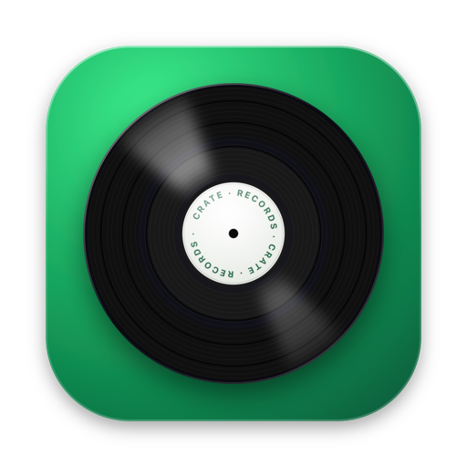
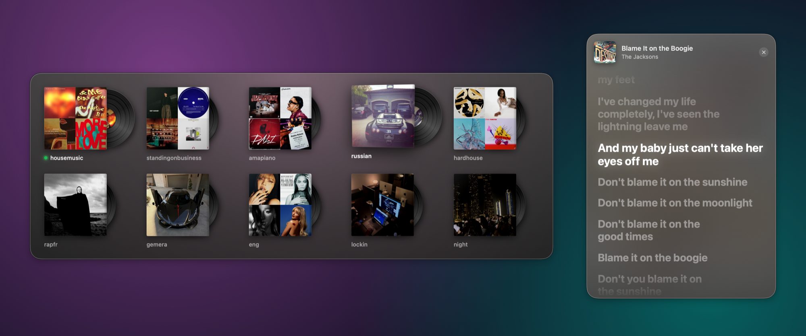
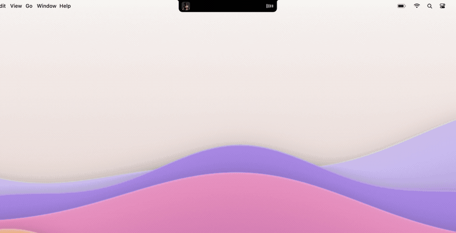

<p align="center">
  
</p>

<h1 align="center">Crate</h1>

<p align="center">
  <b>Your Spotify playlists as a crate of records.</b><br>
  Pick one, read the lyrics, skip tracks, all from your keyboard, without ever opening Spotify's window.
</p>

<p align="center">
  
  
  
  
</p>

<p align="center">
  <a href="README.fr.md">🇫🇷 Lire en français</a>
</p>



## What it does

| | |
|---|---|
| **⌘ ⌥ 0 · Pick a playlist** | A grid of record sleeves pops up. Hover one and the vinyl slides out and spins, the background takes the color of the cover. Click it (or press its number) and it starts playing on shuffle. Spotify stays hidden, even if it was closed. |
| **⌘ ⌥ - · Lyrics** | A floating window shows the lyrics of the current song, synced line by line like karaoke. Click a line to jump to that moment in the song. The line being sung lights up word by word: the ♪ button turns that off, to light the whole line up at once. The button next to × shrinks the window to a small strip with just the current and next lines. On macOS 26, Crate can [listen to the song](#lyrics-follow-singing) to light each word up exactly when it's sung. |
| **⌘ ⌥ = · Next track** | Skips to the next song, from any app. |
| **Now playing** | When you skip a song with the shortcut, a capsule with the new song's record, title and artist shows up in the top-right corner for a few seconds. On a MacBook with a notch, the cover and dancing bars sit on each side of the camera; move the mouse over the notch and it opens into a player with the progress bar (drag it to move in the song), previous, play/pause and next. Both can be turned off in the `[now playing]` section of `config.txt`. |

<p align="center">
  
</p>

Some details:

- The playlist that's playing is marked with a green dot and its record keeps spinning.
- If the sound is muted, or Spotify's volume is at 0, Crate turns it back up when you start a playlist.
- Arrow keys, Return, Escape and the number keys 1…0 work in the picker. ⌘ , opens your playlist list.
- In the lyrics window (after a click in it), ← and → move this song's lyrics 0.1 s earlier or later. Crate remembers it.
- Your shortcuts and playlists live in a plain text file, and changes apply as soon as you save it.
- The interface is in English or French, following your Mac's language.

## Free, and no Premium needed

By default, Crate doesn't use Spotify's Web API (which requires Premium to control playback, plus a developer account). It **drives the Spotify app already on your Mac**, the same way Apple's Shortcuts or AppleScript can, so it works with **free Spotify accounts**. There's no login, no API key and nothing to configure on Spotify's side.

- **Covers** come from Spotify's public embed info (the same data shown when you paste a link in a chat).
- **Lyrics** come from [LRCLIB](https://lrclib.net), a free and open lyrics database. When it only has a song's plain text, [listening](#lyrics-follow-singing) can time it.

> Spotify's own rules still apply: on a free account you'll hear ads, and Spotify decides how many skips you get.

On Premium, you can also [connect Crate to the Web API](#premium-no-spotify-window) so the Spotify window never flashes up when a playlist starts.

## Installation

Takes about 5 minutes. You need a Mac with **macOS 14 Sonoma or later** and the [Spotify desktop app](https://www.spotify.com/download).

### 1. Install Apple's developer tools

Crate is built on your Mac from its source code, which needs Apple's free Command Line Tools. Open **Terminal** (in Applications › Utilities) and paste:

```bash
xcode-select --install
```

Click **Install** in the window that appears, then wait for it to finish (a few minutes). If it says the tools are already installed, you're good.

### 2. Download and install Crate

Still in Terminal, paste this line:

```bash
git clone https://github.com/amndrd/crate.git ~/Crate && ~/Crate/install.sh
```

This downloads Crate into a `Crate` folder in your home folder, builds the app and sets it to start automatically when you log in. When it's done, `config.txt` opens in TextEdit.

> You can move the folder later: Crate follows it and keeps starting at login. Avoid putting it in Desktop, Documents or Downloads: macOS protects those folders and would ask for extra permission.

### 3. Add your playlists

`config.txt` lists your playlists, one Spotify link per line. To get a playlist's link in Spotify, click **•••** next to it, then **Share › Copy link to playlist**.

```ini
[playlists]
Chill = https://open.spotify.com/playlist/37i9dQZF1DWWQRwui0ExPn
Workout = https://open.spotify.com/playlist/37i9dQZF1DX76Wlfdnj7AP
https://open.spotify.com/album/2noRn2Aes5aoNVsU6iWThc
```

- The name before `=` is optional: without it, Crate uses the playlist's name from Spotify.
- Albums and artists work too.
- The first 10 can be picked with the number keys 1…0.

Save the file (⌘ S). Crate reloads it right away and shows how many playlists it found.

### 4. Try it

Press **⌘ ⌥ 0** (Command + Option + 0) and pick a record.

The first time, macOS asks **“Crate wants to control Spotify”**: click **OK**. If you clicked “Don't Allow” by mistake, go to **System Settings › Privacy & Security › Automation › Crate** and turn on Spotify.

That's it. 🎶

## Shortcuts

| Shortcut | US / UK keyboard | French / Belgian AZERTY |
|---|---|---|
| Pick a playlist | ⌘ ⌥ 0 | ⌘ ⌥ à |
| Show / hide lyrics | ⌘ ⌥ - | ⌘ ⌥ ) |
| Next track | ⌘ ⌥ = | ⌘ ⌥ - |

Shortcuts use **physical keys**: the 0 key and the two keys to its right, whatever your keyboard layout. To change them, edit the `[shortcuts]` section of `config.txt`:

```ini
[shortcuts]
picker = cmd+option+0
lyrics = cmd+option+-
next = cmd+option+=
```

Modifiers are `cmd`, `option`, `ctrl` and `shift`. Keys are named after where they sit on a US keyboard (`a`…`z`, `0`…`9`, `-`, `=`, `[`, `]`, `;`, `'`, `,`, `.`, `/`, `f1`…`f12`, `space`, arrows `left`…). Write `none` to turn a shortcut off. If a shortcut is already taken by another app, Crate tells you so.

## More

<details>
<summary><b>Private playlists have no cover</b></summary>

Spotify only shares a private playlist's cover with its owner, so Crate shows a green sleeve with its initial instead. Either make the playlist public in Spotify, or drop a picture in the `covers` folder named after the playlist, e.g. `covers/Chill.jpg` (`.png` works too).
</details>

<details>
<summary><b>Use Crate from Shortcuts, Raycast, a Stream Deck…</b></summary>

Crate also takes commands from the command line, so anything that can run a shell command can trigger it:

```bash
~/Crate/Crate.app/Contents/MacOS/Crate picker   # open the picker
~/Crate/Crate.app/Contents/MacOS/Crate lyrics   # show / hide lyrics
~/Crate/Crate.app/Contents/MacOS/Crate next     # next track
~/Crate/Crate.app/Contents/MacOS/Crate play https://open.spotify.com/playlist/…   # play a playlist on shuffle
~/Crate/Crate.app/Contents/MacOS/Crate config   # open config.txt
```

In the Shortcuts app, use the **Run Shell Script** action with one of these lines.
</details>

<details>
<summary><b id="premium-no-spotify-window">Premium: start playlists without the Spotify window showing up</b></summary>

When an app tells Spotify to play a playlist, Spotify brings its window to the front. Crate hides it right away, but you may see it flash. With a Premium account, Crate can start playlists through Spotify's Web API instead, and the window doesn't move at all:

1. Go to the [Spotify developer dashboard](https://developer.spotify.com/dashboard), log in and click **Create app**. Any name and description will do.
2. Under **Redirect URIs**, add `http://127.0.0.1:8888/callback`. Under **Which API/SDKs are you planning to use?**, tick **Web API**. Save.
3. Copy the app's **Client ID** and run:

```bash
~/Crate/Crate.app/Contents/MacOS/Crate connect <Client ID>
```

Your browser opens Spotify: click **Agree**, and you're done. Crate keeps the connection in `~/Library/Application Support/Crate`. If the API ever fails (no internet, connection revoked), Crate goes back to driving the Spotify app. To stop using the API: `Crate disconnect`.
</details>

<details>
<summary><b id="lyrics-follow-singing">Lyrics that follow the singing (macOS 26)</b></summary>

LRCLIB only says when each line starts, so Crate guesses when each word is sung, and it's often a bit off. With listening on, Crate hears the song as it plays, macOS speech recognition tells when each word is sung, and Crate lines that up with the lyrics: each word lights up when it's actually sung. To turn it on, add this to `config.txt`:

```ini
[lyrics]
listen = on
```

- **Only while the lyrics window is open, only Spotify.** The audio goes straight to macOS speech recognition, on your Mac. Nothing is recorded, saved or sent anywhere: Crate only keeps when each word is sung.
- **macOS asks you once** to allow Crate to record the computer's audio (System Settings › Privacy & Security › Screen & System Audio Recording). While Crate listens, the recording indicator shows in the menu bar.
- **It gets better as you listen.** The words are recognized a few seconds after they're sung, so the first time a song plays, Crate mostly corrects the lines' timing; from the next time, every word is in place. After two full listens a song is known and Crate stops listening to it. A small waveform next to the artist means the song is timed by listening.
- **Plain lyrics become synced.** When LRCLIB only has the text of a song, Crate times it after hearing it once in full, if it recognized most of the lines, the first one included. Otherwise the text stays plain: wrong times would be worse.
- **Languages**: about 30 (English, French, Spanish, German, Italian, Portuguese, Japanese, Chinese…). The first time, macOS may download its recognition for a new language. Others (Russian, for instance) keep LRCLIB's timing.
- **When it can't tell**, with heavy Auto-Tune or vocals buried in the music for instance, Crate keeps LRCLIB's timing: listening never makes lyrics worse.
- It needs macOS 26, and Crate built with Apple's tools for it (Command Line Tools 26: run `softwareupdate --list`, install the update, then `./install.sh` again). Otherwise Crate works as before and says so when `listen = on`.
</details>

<details>
<summary><b>Update</b></summary>

```bash
cd ~/Crate && git pull && ./install.sh
```
</details>

<details>
<summary><b>Uninstall</b></summary>

```bash
~/Crate/uninstall.sh && rm -rf ~/Crate
```

This stops Crate, removes it from login items and deletes its cache, permissions and Spotify connection.
</details>

<details>
<summary><b>Troubleshooting</b></summary>

- **Nothing happens when I press the shortcut.** Check Crate is running: `launchctl list | grep crate`. If not, run `~/Crate/install.sh` again. Errors are logged in `/tmp/crate.log`.
- **“Shortcut … is used by another app”.** Pick another one in `config.txt`.
- **The playlist doesn't start.** Make sure Crate is allowed to control Spotify in System Settings › Privacy & Security › Automation.
- **“No lyrics found”.** LRCLIB doesn't have every song, especially recent or less-known ones. Crate looks again a few days later.
- **Lyrics a little early or late.** Press ← or → in the lyrics window for this song, or set `delay` in the `[lyrics]` section of `config.txt` for all of them (+ later, - earlier). Crate already allows for the delay of Bluetooth headphones.
- **“Crate can't hear Spotify”.** With `listen = on`, allow Crate in System Settings › Privacy & Security › Screen & System Audio Recording, under System Audio Recording Only.
- **`xcrun: error: invalid active developer path`.** The Command Line Tools are missing: see step 1.
</details>

<details>
<summary><b>Privacy</b></summary>

Crate runs entirely on your Mac. It has no account, no analytics and no server. The only network requests it makes are to `open.spotify.com` (playlist covers) and `lrclib.net` (lyrics), plus `api.spotify.com` and `accounts.spotify.com` if you connected it to the Web API. Covers, lyrics and word timings are cached in `~/Library/Caches/Crate`. With `listen = on`, Spotify's audio is analyzed on your Mac by macOS speech recognition while the lyrics window is open, and is never recorded or sent.
</details>

<details>
<summary><b>How it's built</b></summary>

A single small macOS app written in Swift and SwiftUI, with no dependencies. It runs in the background (no Dock icon) and is started at login by a LaunchAgent.

| File | Role |
|---|---|
| `Sources/App.swift` | Global shortcuts (Carbon hot keys), config reloading, commands |
| `Sources/Picker.swift` | The record crate: sleeves, spinning vinyls, keyboard navigation |
| `Sources/Lyrics.swift` | Lyrics window, LRCLIB lookup and LRC parsing |
| `Sources/AudioListener.swift` | `listen = on`: hears Spotify (Core Audio tap) and macOS speech recognition |
| `Sources/LyricsSync.swift` | Lines the recognized words up with the lyrics; times plain lyrics |
| `Sources/LyricsLearner.swift` | Learns word timings while you listen, song by song, and caches them |
| `Sources/Spotify.swift` | Talks to the Spotify app through AppleScript |
| `Sources/WebAPI.swift` | Optional Web API connection (Premium): `Crate connect`, starting playlists |
| `Sources/Library.swift` | Covers and playlist names, with their cache |
| `Sources/Config.swift` | Reads `config.txt`, keyboard shortcuts |
| `install.sh` · `build.sh` · `uninstall.sh` | Build, install, remove |

To build by hand: `./build.sh`, which produces `Crate.app`.
</details>

## Credits

- Lyrics by [LRCLIB](https://lrclib.net), a community-run lyrics database. Consider contributing lyrics there!
- Crate isn't affiliated with, endorsed by or sponsored by Spotify. Spotify is a trademark of Spotify AB.

## License

[MIT](LICENSE)
